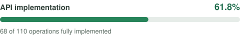

# Mysa Client

> Unofficial and unaffiliated with Mysa. Use at your own risk.

An asynchronous Python library for Mysa thermostats. It talks to Mysa's cloud,
to a thermostat on your network over HomeKit, and optionally to Mysa's MQTT
service for live readings on the older models. Your application supplies the
credentials and decides when to connect, poll and store anything.

**[Documentation and task index](https://github.com/SokolskyNikita/mysa-client/blob/main/docs/README.md)** ·
[Connect a client](https://github.com/SokolskyNikita/mysa-client/blob/main/docs/guides/connect.md) ·
[Examples](https://github.com/SokolskyNikita/mysa-client/blob/main/examples/README.md) · [Changelog](https://github.com/SokolskyNikita/mysa-client/blob/main/CHANGELOG.md)

Powers [Mysa Local for Home Assistant](https://github.com/SokolskyNikita/mysa-homeassistant).
Use that repository to install it in Home Assistant and for its entities and settings.

## Installation

Python 3.11 or newer is required:

```sh
python -m pip install mysa-client
```

Optional transports:

```sh
python -m pip install 'mysa-client[homekit,mqtt]'
```

Import `mysa_client.cloud`, `mysa_client.homekit`, or `mysa_client.mqtt`.
Installing extras or importing the package does not start a connection.

## Quick start

Sign in, list the account's thermostats and read each one:

```python
import asyncio

import aiohttp

from mysa_client.cloud import MysaAuth, MysaClient

USER_AGENT = "my-app/1.0"


async def main() -> None:
    async with aiohttp.ClientSession() as session:
        auth = MysaAuth(session, user_agent=USER_AGENT)
        await auth.sign_in("account@example.com", "your-password")
        client = MysaClient(session, auth, user_agent=USER_AGENT)

        account = await client.bootstrap()
        for device_id in account.devices:
            state = await client.get_state(device_id)
            print(state.model, state.room_temperature, state.heat_setpoint)


asyncio.run(main())
```

Temperatures are in °C. To change one, build a `Setpoint` with
[`SetpointRules`](https://github.com/SokolskyNikita/mysa-client/blob/main/docs/reference/python/cloud.md#setpoint-rules), which rounds
to the thermostat's step and checks its range; every write requires one. A
request the cloud accepts is not proof that the thermostat applied it, so read
the state back.

## Examples

Runnable scripts are in [`examples/`](https://github.com/SokolskyNikita/mysa-client/blob/main/examples/README.md):

- <a id="cloud-example"></a>**Cloud:** `python examples/cloud_basic.py` signs in with `MYSA_EMAIL` and
  `MYSA_PASSWORD`, saves the refresh token with owner-only permissions, and
  only reads. Set `MYSA_SET_CELSIUS` to change a target on purpose. See
  [connecting clients](https://github.com/SokolskyNikita/mysa-client/blob/main/docs/guides/connect.md).
- <a id="device-semantics-and-optional-runtime-example"></a>**Device state without a network:** `python examples/runtime_basic.py` uses
  synthetic data and needs no credentials. See
  [state and command confirmation](https://github.com/SokolskyNikita/mysa-client/blob/main/docs/guides/state-and-commands.md) and
  [runtime composition](https://github.com/SokolskyNikita/mysa-client/blob/main/docs/guides/runtime.md).
- <a id="homekit-example"></a>**HomeKit:** [discovery, pairing and saved credentials](https://github.com/SokolskyNikita/mysa-client/blob/main/docs/guides/connect.md#homekit).
- <a id="mqtt-example"></a>**MQTT:** [sessions and live reporting](https://github.com/SokolskyNikita/mysa-client/blob/main/docs/guides/connect.md#mqtt).
  MQTT commands are experimental; see the [evidence](https://github.com/SokolskyNikita/mysa-client/blob/main/docs/evidence/mqtt.md).

Keep passwords and tokens out of source control.

## API support and goals

<!-- api-progress:start -->
[](https://github.com/SokolskyNikita/mysa-client/blob/main/docs/api-coverage.md)

**68.5% of known Mysa API operations fully implemented (76/111).**

Cloud & account APIs: 64/89 (71.9%); Local & provisioning APIs: 12/22 (54.5%).
<!-- api-progress:end -->

The [API inventory](https://github.com/SokolskyNikita/mysa-client/blob/main/docs/api-coverage.md) measures implemented operation breadth,
not hardware validation or test coverage. Hardware observations cover two
Baseboard Lites (`BB-V2-0-L`, firmware `3.17.5.13`); other-model mappings remain
app-derived or simulated unless stated. See [evidence and compatibility](https://github.com/SokolskyNikita/mysa-client/blob/main/docs/evidence/README.md).

## Public API

The [Python API index](https://github.com/SokolskyNikita/mysa-client/blob/main/docs/README.md#python-api-contracts) covers the cloud,
HomeKit, MQTT and runtime interfaces, including which submodules are supported
imports. <a id="ownership-and-error-handling"></a>Timeouts, error types, retries and closing connections are described
per transport, starting with the [client lifecycle](https://github.com/SokolskyNikita/mysa-client/blob/main/docs/guides/connect.md#lifecycle-and-errors).

## Development and release

```sh
git clone https://github.com/SokolskyNikita/mysa-client.git
cd mysa-client
python -m pip install -e '.[homekit,mqtt]' --group test --group lint --group build
tools/check   # formatting, lint, types, docs and tests in a few seconds
```

`tools/check` skips the packaging steps that CI runs (build, artifact checks, the installed-wheel
tests with coverage, and the cloud-only install). With [uv](https://docs.astral.sh/uv/), `uv venv`
and `uv pip install` in place of pip set up a fresh environment in about a second.

See [documentation maintenance](https://github.com/SokolskyNikita/mysa-client/blob/main/docs/maintenance.md) for offline checks and
[releasing](https://github.com/SokolskyNikita/mysa-client/blob/main/docs/releasing.md) for validation and publishing. Licensed under
[MIT](https://github.com/SokolskyNikita/mysa-client/blob/main/LICENSE).
