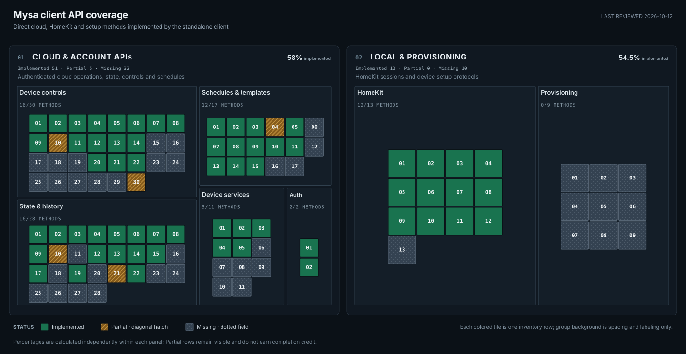

# Mysa client API coverage

Last reviewed: **2026-10-12**

Client baseline: **mysa-client 0.1.2**

This map tracks direct cloud, HomeKit, and device-setup API capabilities in the
standalone client. HA orchestration and user-facing management behavior have a
separate map in the [Mysa Home Assistant repository](https://github.com/SokolskyNikita/mysa-homeassistant/blob/main/docs/implementation/progress.md).

<!-- api-coverage:start -->

**01 Cloud & account APIs:** 52 of 88 known rows fully implemented (59.1%). Partial: 5; missing: 31.

**02 Local & provisioning APIs:** 12 of 22 known rows fully implemented (54.5%). Partial: 0; missing: 10.

| Layer | Category | Implemented | Partial | Missing | Total |
| --- | --- | ---: | ---: | ---: | ---: |
| Cloud & account APIs | Authentication | 2 | 0 | 0 | 2 |
| Cloud & account APIs | State & history | 17 | 2 | 9 | 28 |
| Cloud & account APIs | Device controls | 16 | 2 | 12 | 30 |
| Cloud & account APIs | Schedules & templates | 12 | 1 | 4 | 17 |
| Cloud & account APIs | Device services | 5 | 0 | 6 | 11 |
| Local & provisioning APIs | HomeKit | 12 | 0 | 1 | 13 |
| Local & provisioning APIs | Provisioning | 0 | 0 | 9 | 9 |
<!-- api-coverage:end -->

[Open the coverage map at full size](api-coverage.svg). Each tile corresponds to
one inventory row; its tooltip gives the complete operation ID, description,
and status. Cloud/account methods and local/provisioning methods have separate
denominators. Partial rows remain visible without receiving completion credit.

## How to read the map

| Status | Meaning |
| --- | --- |
| Implemented | A callable wrapper, named codec/accessor, or notification interface provides the listed operation. |
| Partial | Some of the named operation is available; its remaining method-level gap is explicit. |
| Missing | This client package has no supported implementation of the operation. |

Only **Implemented** counts toward a panel percentage. The README progress bar
combines both panels, dividing all implemented rows by all known rows.
This measures breadth of the listed operations; it does not measure effort,
severity, hardware coverage, or whether an API request caused a physical effect.
Adding a newly found operation can lower a score.

## Scope and evidence

This inventory covers known consumer cloud, HomeKit, and device-setup API
operations for the Mysa client package. It tracks request methods, encoders,
response parsing, and notification interfaces. It does not claim that a method
is useful for every model or that a successful request proves a physical effect.

The baseline comes from the October 10–12 research, recovered app behavior,
current client code, fixtures, and protocol tests. Count equivalent S/R/L host
aliases once. Distinct protocol operations such as structured versus legacy
state acquisition and authenticated HomeKit sessions remain separate. Rows
count named methods or bounded operation families; related CRUD variants may
share a row and are complete only when all listed variants exist. Hardware-
inapplicable features do not become requirements for every model.

### AC IR setup and lock-mode research

The Android app comparison (3.54.1 versus 4.20.1) identifies extended physical
lock modes and recovered AC routes `/ac/remote-match/` and
`/mysa-legacy/{device}/ac-sync`, alongside IR setup and delivery workflows.
These are method candidates, not validated request contracts: a route name does
not establish that a PIN flow, remote match, or physical IR effect succeeds.
The missing remote-match/synchronization family is counted in
[API-SETUP-09](#api-setup-09); extended lock modes are part of
[API-WRITE-19](#api-write-19). MQTT setup/delivery remains subject to the
separate authorization evidence in [MQTT reference](mqtt.md).

Home Assistant integration policy, source selection, command confirmation,
setup, recovery, and hardware validation are tracked in the
[HA management map](https://github.com/SokolskyNikita/mysa-homeassistant/blob/main/docs/implementation/progress.md).

## Raw API method inventory

IDs beginning with `API-` belong to the first panel. Rows identify a method or
bounded protocol operation, not an entire end-user feature or a Python line count.

### Authentication

| ID | Operation | Status | Evidence and remaining gap |
| --- | --- | --- | --- |
| API-AUTH-01 | Cognito email/password sign-in using SRP | Implemented | [auth.py](https://github.com/SokolskyNikita/mysa-client/blob/main/src/mysa_client/cloud/auth.py) implements InitiateAuth and RespondToAuthChallenge; protocol and body tests are in [test_srp.py](https://github.com/SokolskyNikita/mysa-client/blob/main/tests/cloud/test_srp.py) and [test_client.py](https://github.com/SokolskyNikita/mysa-client/blob/main/tests/cloud/test_client.py). |
| API-AUTH-02 | Cognito refresh-token exchange and ID-token renewal | Implemented | [auth.py](https://github.com/SokolskyNikita/mysa-client/blob/main/src/mysa_client/cloud/auth.py) refreshes ID tokens and exposes replacement refresh tokens through its callback; persistence remains caller-owned. |

### State and history

| ID | Operation | Status | Evidence and remaining gap |
| --- | --- | --- | --- |
| API-READ-01 | Read structured state for a batch of device IDs | Implemented | [client.py](https://github.com/SokolskyNikita/mysa-client/blob/main/src/mysa_client/cloud/client.py) get_states() calls POST /state/batch, retains per-device failures, and parses each returned state. |
| API-READ-02 | Read structured state for one device | Implemented | [client.py](https://github.com/SokolskyNikita/mysa-client/blob/main/src/mysa_client/cloud/client.py) get_state() calls GET /state/{id}; this differs from batch state and legacy telemetry. |
| API-READ-03 | Read legacy live state for a batch of devices | Implemented | [client.py](https://github.com/SokolskyNikita/mysa-client/blob/main/src/mysa_client/cloud/client.py) get_legacy_states() parses GET /devices/state with per-field clocks; R and L host copies count once. |
| API-READ-04 | Parse room temperature and humidity readings | Implemented | [models.py](https://github.com/SokolskyNikita/mysa-client/blob/main/src/mysa_client/cloud/models.py) names and parses structured and legacy fields; humidity remains model/source dependent. |
| API-READ-05 | Parse operating mode and heat/cool/AUTO targets | Implemented | [models.py](https://github.com/SokolskyNikita/mysa-client/blob/main/src/mysa_client/cloud/models.py) parses structured target/mode fields and legacy setpoint/mode values. The AUTO target pair is a structured-state capability; source arbitration is assessed separately. |
| API-READ-06 | Parse Mini-Split AC target, fan speed, and swing state | Implemented | [models.py](https://github.com/SokolskyNikita/mysa-client/blob/main/src/mysa_client/cloud/models.py) parses structured target/fan/swing state and AC remote capabilities. This row covers the known structured control-state fields; legacy data need not contain the same fields. |
| API-READ-07 | Parse Central HVAC mode, AUTO pair, stages, and fan configuration | Implemented | [models.py](https://github.com/SokolskyNikita/mysa-client/blob/main/src/mysa_client/cloud/models.py) parses known structured HVAC state and capability fields; code mappings are experimental and model-gated. |
| API-READ-08 | Parse heating activity and HVAC fan runtime | Implemented | [models.py](https://github.com/SokolskyNikita/mysa-client/blob/main/src/mysa_client/cloud/models.py) names duty cycle, HVAC stage, and fan runtime/configuration fields; interval duty is not an instantaneous relay reading. |
| API-READ-09 | Parse connection status and observation timestamps | Implemented | [models.py](https://github.com/SokolskyNikita/mysa-client/blob/main/src/mysa_client/cloud/models.py) and [observations.py](https://github.com/SokolskyNikita/mysa-client/blob/main/src/mysa_client/cloud/observations.py) preserve source-specific timestamps and connection time; freshness arbitration is outside this panel. |
| API-READ-10 | Parse RSSI, internal temperatures, and free heap | Partial | RSSI is a named field in [models.py](https://github.com/SokolskyNikita/mysa-client/blob/main/src/mysa_client/cloud/models.py); internal temperatures and free heap remain in retained raw payloads without named accessors. |
| API-READ-11 | Parse measured voltage, current, power, and energy telemetry | Missing | The structured response is retained by [models.py](https://github.com/SokolskyNikita/mysa-client/blob/main/src/mysa_client/cloud/models.py), but these measurements lack named typed accessors; runtime estimates do not count as measured electrical data. |
| API-READ-12 | Read model, firmware, name, time zone, and stored device settings | Implemented | [models.py](https://github.com/SokolskyNikita/mysa-client/blob/main/src/mysa_client/cloud/models.py) DeviceRecord, DeviceState, and FirmwareInfo expose supported metadata fields from bootstrap/state/records. |
| API-READ-13 | Read per-device capabilities, ranges, and model features | Implemented | [client.py](https://github.com/SokolskyNikita/mysa-client/blob/main/src/mysa_client/cloud/client.py) get_capabilities() and [models.py](https://github.com/SokolskyNikita/mysa-client/blob/main/src/mysa_client/cloud/models.py) Capabilities.from_api() decode GET /capabilities/{id}; some app flags remain model-dependent. |
| API-READ-14 | Read AC remote-supported modes, fan speeds, swing, and modified keys | Implemented | [models.py](https://github.com/SokolskyNikita/mysa-client/blob/main/src/mysa_client/cloud/models.py) DeviceRecord provides named AC capability accessors; actual remote setup/matching is a separate missing operation. |
| API-READ-15 | Read runtime and temperature usage summaries | Implemented | [client.py](https://github.com/SokolskyNikita/mysa-client/blob/main/src/mysa_client/cloud/client.py) get_usage() and [models.py](https://github.com/SokolskyNikita/mysa-client/blob/main/src/mysa_client/cloud/models.py) UsageDay parse summary buckets from /telemetry/usage/{id}. |
| API-READ-16 | Read detailed raw measurement history | Missing | Research identifies POST /batchReadings/v2/{id}; [client.py](https://github.com/SokolskyNikita/mysa-client/blob/main/src/mysa_client/cloud/client.py) has no wrapper or parser for that request. |
| API-READ-17 | Read state-change history | Implemented | [client.py](https://github.com/SokolskyNikita/mysa-client/blob/main/src/mysa_client/cloud/client.py) get_state_history() parses timestamped changes from GET /state/history/{id}. |
| API-READ-18 | Read legacy target/setpoint history | Missing | The legacy POST /energy/setpoints/device/{id} query is documented in the [cloud protocol reference](https://github.com/SokolskyNikita/mysa-client/blob/main/src/mysa_client/cloud/README.md); no matching wrapper/parser exists. |
| API-READ-19 | Read offered firmware update and installed/allowed versions | Implemented | [client.py](https://github.com/SokolskyNikita/mysa-client/blob/main/src/mysa_client/cloud/client.py) get_firmware_info() and [models.py](https://github.com/SokolskyNikita/mysa-client/blob/main/src/mysa_client/cloud/models.py) FirmwareInfo parse GET /devices/update_available/{id}. |
| API-READ-20 | Read the firmware version catalog | Missing | The app route GET /devices/firmware is identified in [Firmware reference](firmware-and-connectivity.md#legacy-devices); the client only reads per-device availability. |
| API-READ-21 | Read demand-response event state | Partial | Structured drState.inEvent is parsed by [models.py](https://github.com/SokolskyNikita/mysa-client/blob/main/src/mysa_client/cloud/models.py); the separate GET /devices/{id}/drstate fallback has no wrapper. |
| API-READ-22 | Read Home/Away/Vacation shortcuts | Implemented | [client.py](https://github.com/SokolskyNikita/mysa-client/blob/main/src/mysa_client/cloud/client.py) get_shortcuts() reads shortcut maps. Saved schedule templates are a separate operation family in API-SCHED-16. |
| API-READ-23 | Read Mysa zones/groups and geofences | Missing | Known consumer GET /zones/{homeId} and geofence read routes are catalogued in [Consumer workflow reference](cloud-workflows.md#retained-app-only-workflow-mechanics); no resource reader exists. |
| API-READ-24 | Read telemetry-alert rules and maintenance reminders | Missing | Known device-alert and home-reminder methods are listed in [Consumer workflow reference](cloud-workflows.md#retained-app-only-workflow-mechanics); no resource reader or typed parser exists. User/account and push-delivery administration are excluded. |
| API-READ-25 | Subscribe to and decode MQTT command acknowledgements and device-event notifications | Implemented | Optional [MysaMqttClient](../src/mysa_client/mqtt/client.py) subscribes only to caller-allowlisted `/out` topics and exposes bounded async events for normalized MCM `msg: 40` telemetry, correlated `msg: 44` acknowledgements, echo replies, and other decoded messages. It uses the legacy Identity Pool by default. See the [MQTT reference](mqtt.md) for hardware evidence and limits; a broker PUBACK is distinct from device confirmation. |
| API-READ-26 | Read legacy device, zone, and home energy summaries | Missing | The known device/zone/home energy summary routes are catalogued in [Consumer workflow reference](cloud-workflows.md#retained-app-only-workflow-mechanics); the package has no request wrapper or typed response parser. |
| API-READ-27 | Request expanded usage attributes and raw telemetry samples | Missing | [Usage query and response](https://github.com/SokolskyNikita/mysa-client/blob/main/docs/cloud-state.md#usage) and [API-READ-27](#api-read-27) distinguish optional attributes/rawReadings from current summary-only get_usage(); no expanded query or named raw-result parser is implemented. |
| API-READ-28 | Read current-service whole-home energy | Missing | The [additional endpoint](cloud-workflows.md#additional-endpoints) POST /energy/v3/{home}/home has no wrapper. it returned 404 on the tested Lite account. |

### Device controls

| ID | Operation | Status | Evidence and remaining gap |
| --- | --- | --- | --- |
| API-WRITE-01 | Send arbitrary structured state update primitive | Implemented | [client.py](https://github.com/SokolskyNikita/mysa-client/blob/main/src/mysa_client/cloud/client.py) update_state() sends the source and supplied sections to POST /state/{id}/update; this primitive is counted once and does not grant credit for every field. |
| API-WRITE-02 | Encode and send heat/cool setpoint changes | Implemented | [commands.py](https://github.com/SokolskyNikita/mysa-client/blob/main/src/mysa_client/cloud/commands.py) temperature_changes() and [client.py](https://github.com/SokolskyNikita/mysa-client/blob/main/src/mysa_client/cloud/client.py) set_temperature() provide the named setpoint command. |
| API-WRITE-03 | Encode separate Central HVAC AUTO heat/cool targets | Implemented | [commands.py](https://github.com/SokolskyNikita/mysa-client/blob/main/src/mysa_client/cloud/commands.py) auto_temperature_changes() encodes the paired target fields; integration exposure is outside raw support. |
| API-WRITE-04 | Encode and send operating mode changes | Implemented | [commands.py](https://github.com/SokolskyNikita/mysa-client/blob/main/src/mysa_client/cloud/commands.py) mode_changes() and [client.py](https://github.com/SokolskyNikita/mysa-client/blob/main/src/mysa_client/cloud/client.py) set_mode() encode structured mode changes. |
| API-WRITE-05 | Encode fixed Central HVAC on/auto/off fan operation | Implemented | [commands.py](https://github.com/SokolskyNikita/mysa-client/blob/main/src/mysa_client/cloud/commands.py) hvac_fan_changes() encodes known on/auto/off runtime fields; control availability comes from capabilities. |
| API-WRITE-06 | Encode Mini-Split AC fan speed | Implemented | [commands.py](https://github.com/SokolskyNikita/mysa-client/blob/main/src/mysa_client/cloud/commands.py) fan_speed_changes() and [client.py](https://github.com/SokolskyNikita/mysa-client/blob/main/src/mysa_client/cloud/client.py) set_fan_speed() encode AC fan commands. |
| API-WRITE-07 | Encode vertical or horizontal AC swing | Implemented | [commands.py](https://github.com/SokolskyNikita/mysa-client/blob/main/src/mysa_client/cloud/commands.py) swing_changes() and [client.py](https://github.com/SokolskyNikita/mysa-client/blob/main/src/mysa_client/cloud/client.py) set_swing() encode the two directions. |
| API-WRITE-08 | Encode physical button lock/unlock | Implemented | [commands.py](https://github.com/SokolskyNikita/mysa-client/blob/main/src/mysa_client/cloud/commands.py) and [client.py](https://github.com/SokolskyNikita/mysa-client/blob/main/src/mysa_client/cloud/client.py) provide the named basic 0/3 lock operation; extended PIN/threshold modes are separate. |
| API-WRITE-09 | Encode paired wake/idle brightness values | Implemented | [commands.py](https://github.com/SokolskyNikita/mysa-client/blob/main/src/mysa_client/cloud/commands.py) and [client.py](https://github.com/SokolskyNikita/mysa-client/blob/main/src/mysa_client/cloud/client.py) encode both active and idle brightness settings. |
| API-WRITE-10 | Encode minimum/maximum setpoint limits | Partial | [client.py](https://github.com/SokolskyNikita/mysa-client/blob/main/src/mysa_client/cloud/client.py) exposes set_setpoint_limit(); the structured command encoder targets heating limits, with no equivalent typed cooling-limit write. |
| API-WRITE-11 | Encode ambient temperature calibration offset | Implemented | [commands.py](https://github.com/SokolskyNikita/mysa-client/blob/main/src/mysa_client/cloud/commands.py) temperature_offset_changes() and [client.py](https://github.com/SokolskyNikita/mysa-client/blob/main/src/mysa_client/cloud/client.py) set_temperature_offset() provide the named operation. |
| API-WRITE-12 | Encode Celsius/Fahrenheit thermostat display units | Implemented | [commands.py](https://github.com/SokolskyNikita/mysa-client/blob/main/src/mysa_client/cloud/commands.py) display_unit_settings() and [client.py](https://github.com/SokolskyNikita/mysa-client/blob/main/src/mysa_client/cloud/client.py) set_display_unit() encode the stored setting. |
| API-WRITE-13 | Encode heater profile for V1/V2/Lite baseboard families | Implemented | [const.py](https://github.com/SokolskyNikita/mysa-client/blob/main/src/mysa_client/cloud/const.py) names known DutyCycleOpt integer values and [client.py](https://github.com/SokolskyNikita/mysa-client/blob/main/src/mysa_client/cloud/client.py) set_heater_type() accepts the integer/enum. This method-level credit does not imply a particular caller interface. |
| API-WRITE-14 | Send arbitrary stored-settings update primitive | Implemented | [client.py](https://github.com/SokolskyNikita/mysa-client/blob/main/src/mysa_client/cloud/client.py) update_settings() sends a settings body and only auto-falls back for a small verified allowlist; this primitive is counted once, not once per arbitrary field. |
| API-WRITE-15 | Configure adaptive brightness and proximity behavior | Missing | The consumer app writes adaptive-brightness/proximity settings and sends a Mysa command; [commands.py](https://github.com/SokolskyNikita/mysa-client/blob/main/src/mysa_client/cloud/commands.py) has no corresponding named codec/setter. |
| API-WRITE-16 | Configure in-floor tracking sensor, probe type, and floor limits | Missing | Fields and app behavior are documented in [cloud-state.md](https://github.com/SokolskyNikita/mysa-client/blob/main/docs/cloud-state.md) and [cloud-workflows.md](cloud-workflows.md); no typed setting encoder or wrapper implements these operations. |
| API-WRITE-17 | Link/unlink or select a remote temperature sensor | Missing | The cross-device sensor-linking feature is described in [cloud-state.md](https://github.com/SokolskyNikita/mysa-client/blob/main/docs/cloud-state.md); this package has no linking operation or typed request encoder. |
| API-WRITE-18 | Configure advanced HVAC equipment and emergency-heat options | Missing | [new-model reference](new-cloud-models.md) documents these model-specific app controls; named encoders cover basic mode, setpoints, and fan operation only. |
| API-WRITE-19 | Reconfigure existing device metadata and app-specific settings | Missing | Claim-time name/time-zone fields exist in [client.py](https://github.com/SokolskyNikita/mysa-client/blob/main/src/mysa_client/cloud/client.py); dedicated existing-record updates for name/time zone, eco/animation, and extended lock modes have no named codecs or semantic wrappers. Generic settings transport is not counted for each field. |
| API-WRITE-20 | Request a legacy-family firmware update | Implemented | [client.py](https://github.com/SokolskyNikita/mysa-client/blob/main/src/mysa_client/cloud/client.py) start_firmware_update() sends the known empty JSON body to /devices/{id}/firmware-update; installation completion is a separate device outcome. |
| API-WRITE-21 | Request temporary cloud live reporting for a home | Implemented | [client.py](https://github.com/SokolskyNikita/mysa-client/blob/main/src/mysa_client/cloud/client.py) start_live_mode() sends the timeout to /mysa-legacy/stream/home/{home}; this is HTTPS request support, not an MQTT subscription. |
| API-WRITE-22 | Replace a shortcut's per-device action map | Implemented | [client.py](https://github.com/SokolskyNikita/mysa-client/blob/main/src/mysa_client/cloud/client.py) update_shortcut() sends the known PATCH /scene/{id} body; application is separate. |
| API-WRITE-23 | Create a Home/Away/Vacation shortcut | Missing | The known POST /scene consumer request is documented in [Consumer workflow reference](cloud-workflows.md#retained-app-only-workflow-mechanics); no create wrapper exists. |
| API-WRITE-24 | Apply a Home/Away/Vacation shortcut to devices | Missing | The known POST /homes/shortcut/apply/{id} operation and timestamp body are described in [cloud-workflows.md](cloud-workflows.md); the package has no apply wrapper. |
| API-WRITE-25 | Create, rename, or remove Mysa zones/groups | Missing | Known consumer zone operations are listed in [Consumer workflow reference](cloud-workflows.md#retained-app-only-workflow-mechanics); the package has no zone request encoder/wrapper. |
| API-WRITE-26 | Create/update/delete geofences and their crossing actions | Missing | Known /geofence and crossing request shapes are documented in [Consumer workflow reference](cloud-workflows.md#retained-app-only-workflow-mechanics); no wrapper or encoder exists. |
| API-WRITE-27 | Configure device telemetry alerts and maintenance reminders | Missing | Known device-alert and home-reminder methods are listed in [Consumer workflow reference](cloud-workflows.md#retained-app-only-workflow-mechanics); no rule/reminder CRUD wrapper exists. |
| API-WRITE-28 | Configure Smart Early On or utility enrollment | Missing | Consumer feature and route families appear in [new-model reference](new-cloud-models.md); exact payload contracts are not fully established and this package has no corresponding request methods. |
| API-WRITE-29 | Set a custom Central HVAC fan-circulation duration | Missing | [commands.py](https://github.com/SokolskyNikita/mysa-client/blob/main/src/mysa_client/cloud/commands.py) encodes only the fixed on/auto/off duration combinations; no arbitrary circulation-period encoder or setter exists. |
| API-WRITE-30 | Encode and send native Central HVAC fan speed | Partial | The generic [client update method](https://github.com/SokolskyNikita/mysa-client/blob/main/src/mysa_client/cloud/client.py) can transmit a caller-built `modes.fan_mode` payload, but there is no named native fan-speed encoder or method. [`hvac_fan_changes()`](https://github.com/SokolskyNikita/mysa-client/blob/main/src/mysa_client/cloud/commands.py) covers fixed on/auto/off runtime combinations only; the HA integration currently constructs the native fan-speed payload in its [thermostat adapter](https://github.com/SokolskyNikita/mysa-homeassistant/blob/main/custom_components/mysa_local/thermostat.py). |

### Schedules and templates

| ID | Operation | Status | Evidence and remaining gap |
| --- | --- | --- | --- |
| API-SCHED-01 | Read modern schedules for a home | Implemented | [client.py](https://github.com/SokolskyNikita/mysa-client/blob/main/src/mysa_client/cloud/client.py) get_schedules() parses GET /schedule?homeId=... and validates schedule/event structure. |
| API-SCHED-02 | Read legacy V1 schedules | Implemented | [client.py](https://github.com/SokolskyNikita/mysa-client/blob/main/src/mysa_client/cloud/client.py) get_all_schedules() reads GET /schedules and validates native V1 snapshots through [schedules.py](https://github.com/SokolskyNikita/mysa-client/blob/main/src/mysa_client/cloud/schedules.py). |
| API-SCHED-03 | Read legacy V2 schedule by device ID | Implemented | [client.py](https://github.com/SokolskyNikita/mysa-client/blob/main/src/mysa_client/cloud/client.py) get_all_schedules() reads GET /schedules/v2/{deviceId}; device IDs and schedule IDs remain distinct. |
| API-SCHED-04 | Encode semantic schedule events and weekday/time fields | Partial | [commands.py](https://github.com/SokolskyNikita/mysa-client/blob/main/src/mysa_client/cloud/commands.py) encode_schedule_events() maps named days, local time, client key, mode and temperature to the modern wire representation. Richer fan/tracking/paired-target schedule variants described in the [schedule reference](cloud-workflows.md#schedules-holds-and-shortcuts) lack named semantic encoders. |
| API-SCHED-05 | Create and attach a modern schedule | Implemented | [client.py](https://github.com/SokolskyNikita/mysa-client/blob/main/src/mysa_client/cloud/client.py) create_schedule() sends the known metadata and event body to POST /schedule. |
| API-SCHED-06 | Edit an existing modern schedule in place | Missing | The required full-body PUT /schedule/{id} fields are documented in [cloud-workflows.md](cloud-workflows.md); the standalone package has no matching request wrapper. |
| API-SCHED-07 | Detach/delete a modern schedule from a device | Implemented | [client.py](https://github.com/SokolskyNikita/mysa-client/blob/main/src/mysa_client/cloud/client.py) delete_schedule() sends DELETE /schedule/{id}/attach/{deviceId}. |
| API-SCHED-08 | Clear legacy V1 schedule for one device | Implemented | [client.py](https://github.com/SokolskyNikita/mysa-client/blob/main/src/mysa_client/cloud/client.py) remove_schedule() writes seven empty weekday arrays with required device/model fields. |
| API-SCHED-09 | Restore a native V1 schedule snapshot | Implemented | [client.py](https://github.com/SokolskyNikita/mysa-client/blob/main/src/mysa_client/cloud/client.py) restore_native_schedule() replays validated native V1 schedule data through the known legacy route. |
| API-SCHED-10 | Create/update a legacy V2 schedule snapshot | Implemented | [client.py](https://github.com/SokolskyNikita/mysa-client/blob/main/src/mysa_client/cloud/client.py) restore_native_schedule() sends the preserved schedule, device IDs, and model to POST /schedules/v2/; general schedule authoring is outside this snapshot method. |
| API-SCHED-11 | Delete/detach a legacy V2 schedule | Implemented | [client.py](https://github.com/SokolskyNikita/mysa-client/blob/main/src/mysa_client/cloud/client.py) remove_schedule() sends schedule ID plus device/model body to DELETE /schedules/v2/{scheduleId}. |
| API-SCHED-12 | Query schedule compatibility | Missing | The known /schedule/compatibility API family is listed in [Additional API findings](cloud-workflows.md#additional-endpoints); no compatibility query wrapper exists. |
| API-SCHED-13 | Read an active schedule hold | Implemented | [client.py](https://github.com/SokolskyNikita/mysa-client/blob/main/src/mysa_client/cloud/client.py) get_hold() reads GET /schedule/hold/{id} and represents 404 as no active hold. |
| API-SCHED-14 | Create permanent or temporary schedule hold | Implemented | [client.py](https://github.com/SokolskyNikita/mysa-client/blob/main/src/mysa_client/cloud/client.py) set_hold() encodes hold type, future start time, state, and optional end time. |
| API-SCHED-15 | Resume schedule after a hold | Implemented | [client.py](https://github.com/SokolskyNikita/mysa-client/blob/main/src/mysa_client/cloud/client.py) resume_schedule() deletes /schedule/hold/{id} and treats absence as already resumed. |
| API-SCHED-16 | Read/create/rename/edit/delete saved schedule templates | Missing | The known /homes/{home}/savedSchedule and create/name/events/delete request family is described in [cloud-workflows.md](cloud-workflows.md); there is no template endpoint wrapper. |
| API-SCHED-17 | Apply a saved schedule template to devices | Missing | The known template PUT .../apply operation is described in [cloud-workflows.md](cloud-workflows.md); the client only recognizes device schedules after creation. |

### Device services

| ID | Operation | Status | Evidence and remaining gap |
| --- | --- | --- | --- |
| API-DEVICE-01 | Account/home/device bootstrap | Implemented | [client.py](https://github.com/SokolskyNikita/mysa-client/blob/main/src/mysa_client/cloud/client.py) bootstrap() and [models.py](https://github.com/SokolskyNikita/mysa-client/blob/main/src/mysa_client/cloud/models.py) Bootstrap parse GET /mobile/bootstrap; profile and home-administration APIs are excluded. |
| API-DEVICE-02 | Read the account device-record collection | Implemented | [client.py](https://github.com/SokolskyNikita/mysa-client/blob/main/src/mysa_client/cloud/client.py) get_devices() and [models.py](https://github.com/SokolskyNikita/mysa-client/blob/main/src/mysa_client/cloud/models.py) DeviceRecord parse the collection and common typed fields. Single-record acquisition is tracked separately in API-DEVICE-06. |
| API-DEVICE-03 | Claim Wi-Fi-only legacy device to a Mysa home | Implemented | [client.py](https://github.com/SokolskyNikita/mysa-client/blob/main/src/mysa_client/cloud/client.py) add_device() encodes the known claim body for V1/V2/Lite, in-floor, and AC. It intentionally rejects V3/Central HVAC/Climate Sensor, which require newer credential setup. |
| API-DEVICE-04 | Replace a retained legacy account device record | Implemented | [client.py](https://github.com/SokolskyNikita/mysa-client/blob/main/src/mysa_client/cloud/client.py) replace_device() sends the documented /devices/purgeadd body to the legacy host; this is an explicit operation. |
| API-DEVICE-05 | Remove a device from the Mysa account | Implemented | [client.py](https://github.com/SokolskyNikita/mysa-client/blob/main/src/mysa_client/cloud/client.py) delete_device() issues DELETE /devices/{id}; schedule/shortcut cleanup is a separate caller responsibility. |
| API-DEVICE-06 | Read one device settings record | Missing | The separate GET /devices/{id} operation appears in the [cloud read matrix](https://github.com/SokolskyNikita/mysa-client/blob/main/src/mysa_client/cloud/README.md#read-matrix); the client only wraps collection acquisition. |
| API-DEVICE-07 | Read newer-model fleet firmware availability | Missing | The [newer OTA service](firmware-and-connectivity.md#newer-ota-service) defines `GET /ota/update/available/{device}`; there is no wrapper in this package. [API-DEVICE-07–10](#api-device-07) tracks model-gated support. |
| API-DEVICE-08 | Start a newer-model fleet firmware update | Missing | The [newer OTA service](firmware-and-connectivity.md#newer-ota-service) defines `POST /ota/update`; there is no wrapper in this package. [API-DEVICE-07–10](#api-device-07) tracks model-gated support. |
| API-DEVICE-09 | Read a newer-model firmware update request status | Missing | The [newer OTA service](firmware-and-connectivity.md#newer-ota-service) defines `GET /ota/update/{requestId}`; there is no wrapper in this package. [API-DEVICE-07–10](#api-device-07) tracks model-gated support. |
| API-DEVICE-10 | Cancel a newer-model firmware update request | Missing | The [newer OTA service](firmware-and-connectivity.md#newer-ota-service) defines `PUT /ota/update/{requestId}/cancel`; there is no wrapper in this package. [API-DEVICE-07–10](#api-device-07) tracks model-gated support. |
| API-DEVICE-11 | Register and configure delivery of device notifications | Missing | [Notification routes and preferences](cloud-workflows.md#retained-app-only-workflow-mechanics) are known app operations; this package has no device-notification delivery integration. General account communication preferences are excluded from this consumer-device inventory. |

### HomeKit

| ID | Operation | Status | Evidence and remaining gap |
| --- | --- | --- | --- |
| API-LOCAL-01 | Parse HomeKit advertisements and refresh pairing endpoints | Implemented | [advertisement.py](https://github.com/SokolskyNikita/mysa-client/blob/main/src/mysa_client/homekit/advertisement.py) validates discovery data, updates current endpoint fields, and keeps stable pairing identity separate. |
| API-LOCAL-02 | Discover HomeKit accessories and find a pairing ID | Implemented | [controller.py](https://github.com/SokolskyNikita/mysa-client/blob/main/src/mysa_client/homekit/controller.py) exposes async_discover() and async_find() through the controller wrapper. |
| API-LOCAL-03 | Start/complete HomeKit PIN pairing and obtain credentials | Implemented | [controller.py](https://github.com/SokolskyNikita/mysa-client/blob/main/src/mysa_client/homekit/controller.py) exposes pairing sessions and returns accepted pairing data through a callback; persistence ordering and rollback guarantees are assessed in MGT-LIFECYCLE-06. |
| API-LOCAL-04 | Load and connect with saved HomeKit pairing data | Implemented | [controller.py](https://github.com/SokolskyNikita/mysa-client/blob/main/src/mysa_client/homekit/controller.py) load_pairing() and [device.py](https://github.com/SokolskyNikita/mysa-client/blob/main/src/mysa_client/homekit/device.py) async_connect() load credentials and open an authenticated session. |
| API-LOCAL-05 | Copy a HomeKit controller pairing | Implemented | [controller.py](https://github.com/SokolskyNikita/mysa-client/blob/main/src/mysa_client/homekit/controller.py) async_copy_pairing() persists the new pairing and attempts cleanup if addition fails ambiguously. |
| API-LOCAL-06 | Remove a HomeKit pairing | Implemented | [controller.py](https://github.com/SokolskyNikita/mysa-client/blob/main/src/mysa_client/homekit/controller.py) async_unpair() removes the controller's saved accessory pairing. |
| API-LOCAL-07 | Read local accessory identity and firmware | Implemented | [device.py](https://github.com/SokolskyNikita/mysa-client/blob/main/src/mysa_client/homekit/device.py) and [models.py](https://github.com/SokolskyNikita/mysa-client/blob/main/src/mysa_client/homekit/models.py) expose manufacturer, model, serial, firmware, and Mysa MAC identity. |
| API-LOCAL-08 | Read local thermostat characteristics | Implemented | [device.py](https://github.com/SokolskyNikita/mysa-client/blob/main/src/mysa_client/homekit/device.py) exposes semantic reads for current/target temperature, current action, target mode, and display units through async_read(). |
| API-LOCAL-09 | Write local thermostat target, mode, or display unit | Implemented | [device.py](https://github.com/SokolskyNikita/mysa-client/blob/main/src/mysa_client/homekit/device.py) async_write() validates/encodes supported semantic fields and checks HAP per-characteristic status. |
| API-LOCAL-10 | Send local Identify operation | Implemented | [device.py](https://github.com/SokolskyNikita/mysa-client/blob/main/src/mysa_client/homekit/device.py) async_identify() wraps the HomeKit Identify characteristic. |
| API-LOCAL-11 | Subscribe to local value/configuration events | Implemented | [device.py](https://github.com/SokolskyNikita/mysa-client/blob/main/src/mysa_client/homekit/device.py) emits semantic HomeKitEvent values and surfaces reconnect/config/capability-refresh notifications; HA's polling policy is not credited. |
| API-LOCAL-12 | Read local field support and numeric limits | Implemented | [device.py](https://github.com/SokolskyNikita/mysa-client/blob/main/src/mysa_client/homekit/device.py) exposes supported fields, modes, and characteristic ranges/steps; actual available fields vary by accessory. |
| API-LOCAL-13 | Read/write HomeKit Wi-Fi configuration | Missing | The vendor-characteristic [Wi-Fi switching protocol](homekit.md#homekit-wi-fi-switching) is documented, but the standalone package has no semantic configuration wrapper. |

### Provisioning

| ID | Operation | Status | Evidence and remaining gap |
| --- | --- | --- | --- |
| API-SETUP-01 | Read BLE Device Information characteristics | Missing | Known GATT identity/firmware characteristics are documented in [Bluetooth reference](bluetooth.md); the client package has no BLE GATT client. |
| API-SETUP-02 | Request and parse nearby Wi-Fi network scan results over BLE | Missing | Scan trigger/count/network-record formats are documented in [Bluetooth reference](bluetooth.md); no package method issues or parses them. |
| API-SETUP-03 | Provision Wi-Fi over BLE and receive transaction status notifications | Missing | The known start/SSID/password/end byte sequence and status codes are in [Bluetooth reference](bluetooth.md); no BLE writer or status subscription exists in the package. |
| API-SETUP-04 | Run SoftAP Wi-Fi provisioning: read identity, send encrypted credentials, verify, reboot | Missing | The /pubkey, /hwid, /model, /network/, /connected/, and /reboot/ sequence is documented in [SoftAP protocol](bluetooth.md#temporary-wi-fi-access-point-setup); no device SoftAP client exists in this package. |
| API-SETUP-05 | Request newer-model cloud pairing credential file | Missing | The known POST /pairing/credentials request is documented in [Bluetooth reference](bluetooth.md); no client method or response decoder exists. |
| API-SETUP-06 | Transfer newer-model credential file over BLE and verify CRC | Missing | File chunks, status fields, and CRC checks are documented in [Bluetooth reference](bluetooth.md); there is no BLE transfer implementation. |
| API-SETUP-07 | Register/finalize newer-model cloud claim | Missing | New-model credential transfer, fleet registration, claim, and /pairing/finalize are described in [cloud-workflows.md](cloud-workflows.md); the current `add_device()` method accepts Wi-Fi-only legacy families. |
| API-SETUP-08 | Retrieve Matter setup code and commission a device | Missing | Matter support and the known setup-code surface are described in [Matter reference](matter.md) and [cloud-workflows.md](cloud-workflows.md); no Matter adapter or commissioning flow exists here. |
| API-SETUP-09 | Match an AC remote and run IR setup/synchronization | Missing | Recovered app routes `/ac/remote-match/` and `/mysa-legacy/{device}/ac-sync` are inventoried in [AC IR setup and lock-mode research](#ac-ir-setup-and-lock-mode-research); exact request contracts remain unvalidated. MQTT setup/delivery is separate from runtime fan/swing support. |

## Keeping the map current

Update the operation row, linked protocol guide, and code/test evidence together.
Preserve API-* identifiers when scope or status changes; assign a new stable ID
for a newly discovered operation. Run `python tools/update_api_coverage.py` to
regenerate the inventory map and README progress bar and summaries, and
`python tools/update_api_coverage.py --check`
to verify them. The generator reads only this repository and does not contact a
thermostat.
